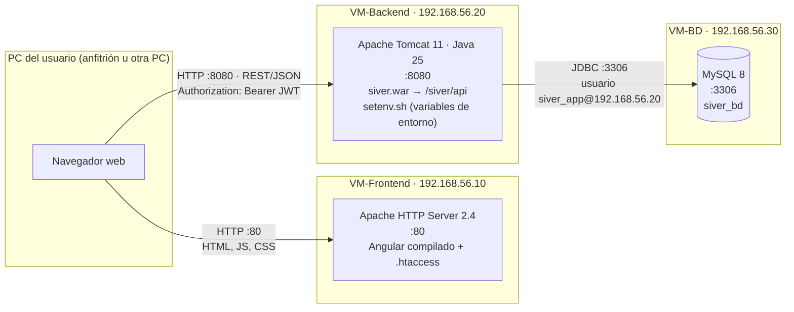
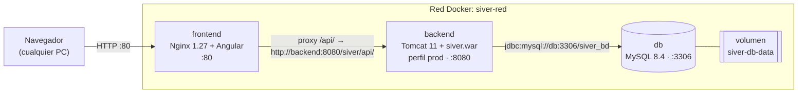

# Despliegue de SIVER

SIVER es una aplicación distribuida de tres componentes. Cada uno corre en su propio servidor
y se comunica con los demás por la red:

| Componente | Tecnología | Servidor | Puerto |
|---|---|---|---|
| Frontend | Angular 22 (compilado) | Apache HTTP Server 2.4 | 80 |
| Backend | Spring Boot 4.1 (`siver.war`) | Apache Tomcat 11 (Java 25) | 8080 |
| Base de datos | MySQL 8 (`siver_bd`) | MySQL Server | 3306 |

Esta carpeta tiene todo lo necesario para dos escenarios:

- **`servidores/`**: 3 máquinas virtuales o 3 PCs físicas (Escenario 2 o 3, **obligatorio**).
- **`docker/`**: un contenedor por componente con Docker Compose: `db`, `backend` y `frontend` (Escenario 4, valor agregado).

---

## 1. Diagrama de despliegue (Escenario 2: máquinas virtuales)



Angular se ejecuta **en el navegador**. Por eso es el navegador (no Apache) el que llama a la API
en `http://192.168.56.20:8080/siver/api`, y por eso el backend debe autorizar con CORS el origen
`http://192.168.56.10`.

### Tabla de direcciones (completar con las IP reales)

| Máquina | Rol | IP | Puertos abiertos | Software |
|---|---|---|---|---|
| VM-Frontend | Servidor web | 192.168.56.10 | 80 | Apache HTTP Server 2.4 |
| VM-Backend | Servidor de aplicaciones | 192.168.56.20 | 8080 | Java 25, Tomcat 11 |
| VM-BD | Servidor de base de datos | 192.168.56.30 | 3306 (solo desde .20) | MySQL 8 |

En VirtualBox, los adaptadores de red van en modo **Red solo-anfitrión (host-only)**
`192.168.56.0/24` o en **Adaptador puente**, con **IP fija** en cada VM.

---

## 2. Escenario 2 / 3: paso a paso

### 2.1 VM-BD (MySQL)

1. Instalar MySQL 8.
2. Crear la base con estructura, triggers y datos:
   ```bash
   mysql -u root -p < docker/mysql-init/01-siver_bd.sql
   mysql -u root -p < docker/mysql-init/02-ef-final.sql
   mysql -u root -p < docker/mysql-init/03-usuarios-demo.sql   # claves de demostración
   ```
3. Que MySQL escuche en la red: [`servidores/bd/mysqld-siver.cnf`](servidores/bd/mysqld-siver.cnf).
4. Crear el usuario de la aplicación, **restringido a la IP del backend**:
   [`servidores/bd/01-usuario-app.sql`](servidores/bd/01-usuario-app.sql).
5. Firewall: abrir el 3306 **solo** para la IP del backend ([`servidores/firewall.md`](servidores/firewall.md)).

### 2.2 VM-Backend (Tomcat 11)

1. Instalar Java 25 y Apache Tomcat 11.
2. Variables de entorno en el servidor (credenciales, JWT, CORS):
   copiar [`servidores/backend/setenv.sh`](servidores/backend/setenv.sh) (Linux) o
   [`setenv.bat`](servidores/backend/setenv.bat) (Windows) a la carpeta `bin` de Tomcat y completar los valores.
3. Generar el WAR en la PC de desarrollo y copiarlo a Tomcat:
   ```bash
   cd siver-backend
   ./mvnw -DskipTests package        # genera target/siver.war
   # copiar target/siver.war a <tomcat>/webapps/
   ```
4. Arrancar Tomcat (`bin/startup.sh` o `startup.bat`). En `logs/catalina.out` debe aparecer
   `Started SiverApplication`.
5. Probar: `http://192.168.56.20:8080/siver/swagger-ui/index.html`.
6. Firewall: abrir el 8080.

### 2.3 VM-Frontend (Apache HTTP Server)

1. En la PC de desarrollo, poner la IP del backend en
   `siver-frontend/src/environments/environment.ts` **antes de compilar**:
   ```ts
   HOST: 'http://192.168.56.20:8080/siver/api'
   ```
2. Compilar para producción:
   ```bash
   cd siver-frontend
   npm ci
   npm run build                     # genera dist/siver-frontend/browser/
   ```
3. Copiar **todo** el contenido de `dist/siver-frontend/browser/` (incluido el archivo oculto
   `.htaccess`) a la carpeta del sitio en Apache (`/var/www/siver` o `C:\Apache24\htdocs\siver`).
4. Configurar el sitio: [`servidores/frontend/siver-apache.conf`](servidores/frontend/siver-apache.conf)
   (`AllowOverride All` y `mod_rewrite`, para que recargar `/pages/ventas` no dé 404).
5. Firewall: abrir el 80.
6. Desde **otra PC**: abrir `http://192.168.56.10` e iniciar sesión.

### 2.4 Escenario 3 (PCs físicas)

Mismos pasos que en las VMs, con tres PCs conectadas al mismo router o punto de acceso. Hay que
fijar la IP de cada PC (o reservarla en el router) y reemplazar `192.168.56.x` por esas IP en:
`environment.ts`, `setenv`, `01-usuario-app.sql` y las reglas de firewall.

---

## 3. Requisitos técnicos del despliegue (cómo se cumple cada uno)

| Req. | Qué pide | Cómo se cumple en SIVER |
|---|---|---|
| 4.1 | La URL de la API no es `localhost` | `environment.ts` apunta a la IP de la VM-Backend antes de `npm run build` |
| 4.2 | Build de producción y rutas que funcionan al recargar | `dist/.../browser` + `.htaccess` con `mod_rewrite` → `index.html` |
| 4.3 | WAR en Tomcat 11, no desde el IDE | `<packaging>war</packaging>`, `ServletInitializer`, `siver.war` en `webapps/` |
| 4.4 | CORS con el origen real del frontend | Variable `CORS_ORIGINS` (lista separada por comas), leída por `CorsConfig` |
| 4.5 | BD accesible solo desde el backend | `bind-address`, usuario `siver_app@IP-backend` y firewall con IP de origen |
| 4.6 | Credenciales y JWT fuera del código | `application.properties` usa `${DB_PASSWORD}`, `${JWT_SECRET}`...; valores en `setenv` o `.env` |
| 4.7 | JWT de punta a punta y restricciones por rol | `Authorization: Bearer`, `SecurityConfig` (403 por rol) y menús por rol en Angular |
| 4.8 | Módulos con datos reales | Clientes, productos, ventas, órdenes, inventario, reportes, auditoría |
| 4.9 | Un registro se ve en la BD | Ej.: registrar una venta y consultar `SELECT * FROM venta ORDER BY id_venta DESC LIMIT 1;` |

---

## 4. Escenario 4: Docker Compose (despliegue distribuido en contenedores)

### 4.1 Arquitectura

Tres servicios independientes, cada uno en su propio contenedor, conectados por la red interna
`siver-red`. Se ubican entre sí por el **nombre del servicio** (`db`, `backend`), nunca por `localhost`.



| Servicio | Contenedor | Imagen | Puerto publicado | Healthcheck |
|---|---|---|---|---|
| `db` | siver-db | mysql:8.4 | 3307 → 3306 | `mysqladmin ping` |
| `backend` | siver-backend | siver-backend:1.0 (Maven → Tomcat 11, Java 25) | 8080 | `curl /siver/v3/api-docs` |
| `frontend` | siver-frontend | siver-frontend:1.0 (Node → Nginx) | 80 | `wget /salud` |

- **Orden de arranque**: `db` healthy → `backend` healthy → `frontend` (`depends_on` + `condition: service_healthy`).
- **Proxy inverso**: el navegador solo habla con Nginx. Nginx reenvía `/api/` al backend, así que la
  URL de la API en Angular es relativa (`/api`): sin IP fija, sin `localhost` y sin CORS.
- **Persistencia**: los datos de MySQL viven en el volumen `siver-db-data`.
- **Correo (opcional)**: `docker compose --profile correo up -d` agrega Mailpit (http://localhost:8025).

### 4.2 Pasos de build y despliegue

```bash
# 0. Requisitos: Docker Desktop encendido; siver-backend y siver-frontend en la misma carpeta (SIVER/)
cd siver-backend/despliegue/docker

# 1. Variables de entorno (una sola vez)
cp .env.example .env          # cambiar las claves

# 2. Construir las imagenes y levantar los 3 servicios
docker compose up --build -d

# 3. Verificar
docker compose ps             # los 3 en "healthy"
docker compose logs backend   # "The following 1 profile is active: prod" y "Server startup in"

# 4. Abrir http://localhost

# Apagar (conserva los datos) / volver a empezar desde cero
docker compose down
docker compose down -v
```

### 4.3 Variables de entorno (`despliegue/docker/.env`)

| Variable | Para qué sirve | Ejemplo |
|---|---|---|
| `DB_ROOT_PASSWORD` | Clave de root de MySQL (solo dentro del contenedor) | (aleatoria) |
| `DB_NAME` | Base de datos | `siver_bd` |
| `DB_USER` / `DB_PASSWORD` | Usuario con el que se conecta el backend | `siver_app` / (aleatoria) |
| `JWT_SECRET` | Clave con la que se firman los tokens (mín. 32 caracteres) | (aleatoria) |
| `JWT_EXPIRACION_MS` | Duración del token | `28800000` (8 h) |
| `CORS_ORIGINS` | Orígenes permitidos si se llama a la API en el :8080 | `http://localhost` |
| `MAIL_HABILITADO` | Envía correos de notificación (perfil `correo`) | `false` |
| `FRONTEND_PUERTO_HOST`, `BACKEND_PUERTO_HOST`, `DB_PUERTO_HOST` | Puertos publicados en la PC | `80`, `8080`, `3307` |

El backend además recibe, desde el `docker-compose.yml`, `SPRING_PROFILES_ACTIVE=prod`, `DB_HOST=db` y `DB_PORT=3306`.
El `.env` **no se sube al repositorio** y las credenciales **no quedan dentro de las imágenes**.

### 4.4 Relación con el ODS 9 (industria, innovación e infraestructura)

- **Servicios independientes**: frontend, backend y base de datos se actualizan, reinician o escalan
  por separado. Si el frontend recibe más visitas, se replica solo Nginx (unos 50 MB) y no toda la
  aplicación, como ocurriría con un monolito.
- **Uso eficiente de recursos**: los contenedores comparten el kernel del anfitrión (no hay un
  sistema operativo completo por servicio, como en una VM); las imágenes multi-stage solo llevan
  lo necesario para ejecutar, y la JVM del backend tiene memoria acotada (`-Xmx512m`).
- **Menos datos por la red**: Nginx comprime (gzip) y guarda en caché los archivos de Angular;
  la paginación del servidor limita cada consulta a 50 registros como máximo.
- **Infraestructura reproducible y resiliente**: el mismo `docker-compose.yml` levanta el sistema
  igual en cualquier equipo; los healthchecks y `restart: unless-stopped` recuperan un servicio
  caído; el volumen conserva los datos.
- **Acceso para una pyme**: Refricentro puede operar con software libre (MySQL, Tomcat, Nginx) en
  hardware modesto o en un VPS económico, y crecer según la demanda.

## 5. Usuarios de demostración

| Rol | Correo | Clave | Qué ve |
|---|---|---|---|
| Administrador | admin@refricentro.pe | Admin2026 | Todo: usuarios, roles, catálogos, auditoría, anular ventas |
| Vendedor | ksanchez@refricentro.pe | Vendedor2026 | Dashboard de ventas, ventas, clientes, inventario y reportes de ventas |
| Técnico | lgutierrez@refricentro.pe | Tecnico2026 | Dashboard de órdenes, órdenes de servicio, clientes y reporte de órdenes |

Las claves de vendedor y técnico las fija `03-usuarios-demo.sql`, solo en la base de demostración.

---

## 6. Problemas frecuentes

| Síntoma | Causa probable | Solución |
|---|---|---|
| "No se pudo conectar con el servidor" | `environment.ts` con IP equivocada, o el 8080 cerrado | Revisar la IP, recompilar y probar `curl http://IP:8080/siver/v3/api-docs` |
| Error de CORS en la consola del navegador | `CORS_ORIGINS` no tiene la dirección exacta del frontend | Poner `http://IP-frontend` (sin `/` al final) y reiniciar Tomcat |
| F5 en `/pages/ventas` da 404 | Falta el `.htaccess` o `AllowOverride All` / `mod_rewrite` | Copiar el `.htaccess` (archivo oculto) y activar `rewrite` |
| Tomcat no arranca: `Could not resolve placeholder 'JWT_SECRET'` | `setenv` no se leyó | Revisar que esté en `bin/` y reiniciar; si es servicio de Windows, usar variables del sistema |
| `Access denied for user 'siver_app'@'...'` | El usuario de MySQL está ligado a otra IP | Crear el usuario con la IP real del backend |
| `Communications link failure` | MySQL escucha solo en 127.0.0.1 o el firewall bloquea | `bind-address = 0.0.0.0` y abrir el 3306 a la IP del backend |
